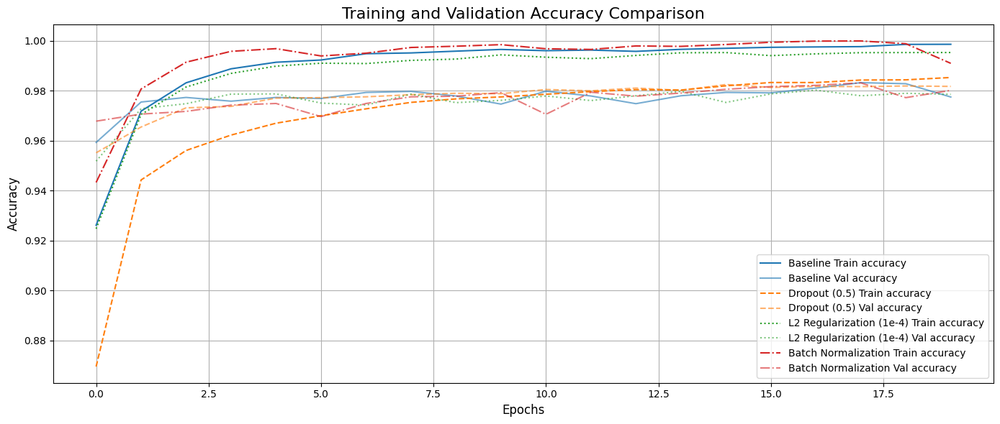
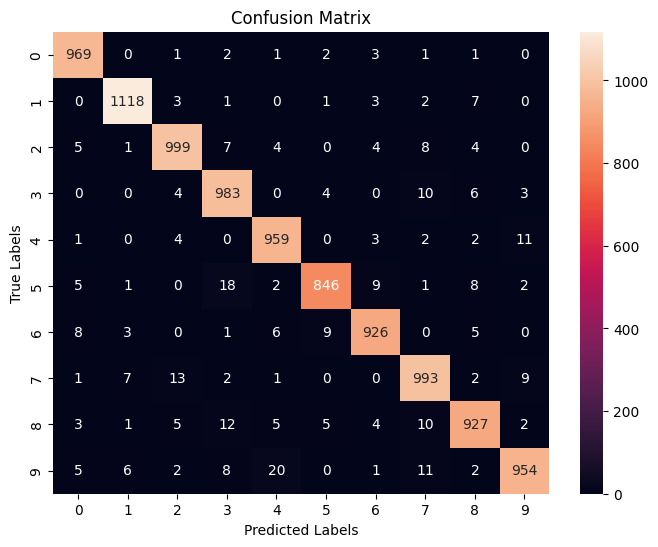

# Regularisation in Deep Networks: Dropout, Weight Decay and Batch Normalisation on MNIST

An experimental comparison of **regularisation techniques for neural networks**, followed by an end-to-end handwritten-digit classifier built on MNIST with Keras/TensorFlow.

<p align="center">
  
  
</p>

## Part 1: Regularisation experiments

The same fully connected network is trained for 20 epochs under four settings, and training and validation curves are compared:

| Setting | What it changes |
|---|---|
| Baseline | No regularisation |
| Dropout | Random deactivation of units during training |
| L2 penalty | Weight decay |
| Batch normalisation | Normalised layer inputs during training |

The baseline reaches 99.9% training accuracy, but validation accuracy stops at 97.8%, a clear sign of overfitting. Every regulariser improves validation accuracy: dropout 98.2%, batch normalisation 98.0%, L2 97.9%.

## Part 2: MNIST classifier

- Data preparation: scaling, reshaping and one-hot encoding of labels
- Model construction and tuning of architecture and optimiser
- Training with validation monitoring, evaluation on the 10,000-image test set (**96.7% accuracy**), and saving of trained weights
- Diagnostics: training history, confusion matrix and inspection of misclassified digits

## Repository structure

```
mnist_regularization.ipynb   # both parts: experiments and final classifier
figures/                     # selected figures exported from the notebook
```

## Reproducing

```bash
pip install tensorflow numpy matplotlib seaborn scikit-learn
```

MNIST is downloaded automatically through `keras.datasets`.

## Context

Developed for the graduate Machine Learning course at Sharif University of Technology (2025).

---
**Shayan Pourmasoomi** · MSc Economics, Sharif University of Technology · [LinkedIn](https://www.linkedin.com/in/shayan-pourmasoomi-8b6206389)
